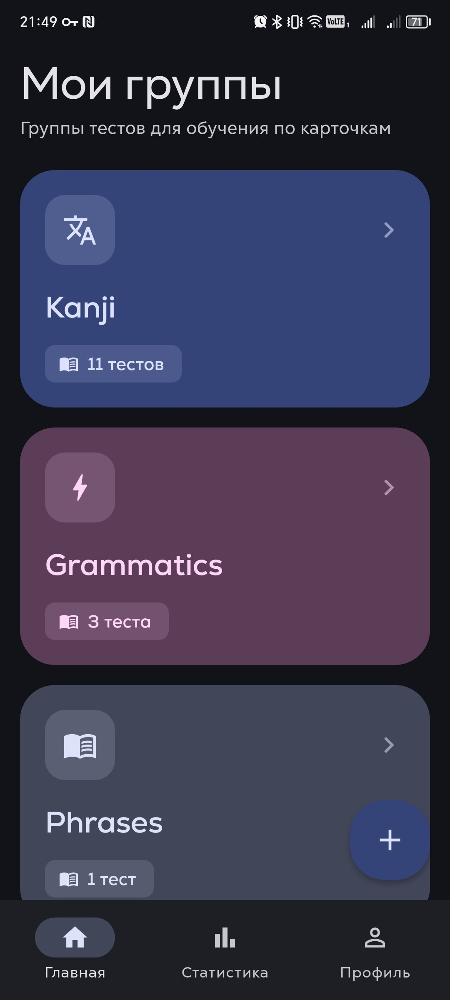
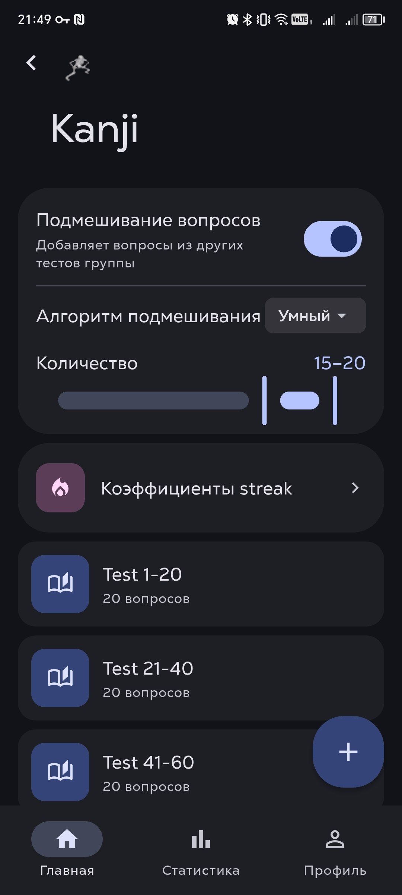
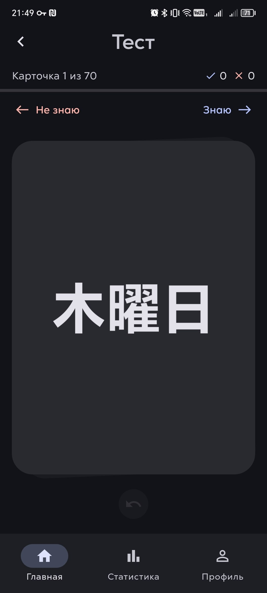
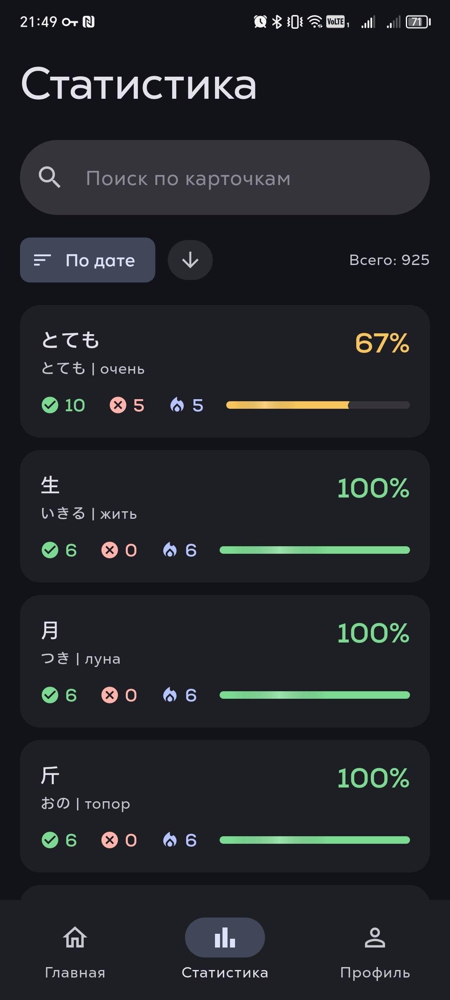
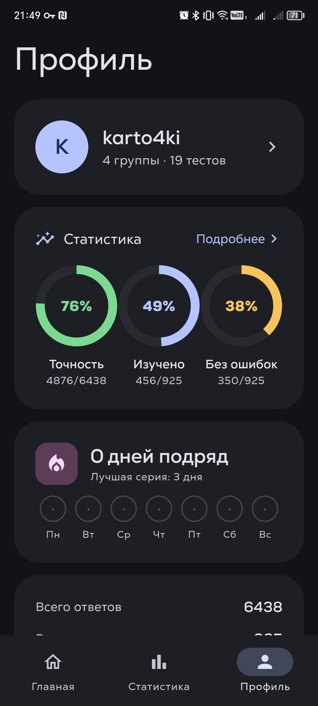

# Quizzerg (karto4ki)

Мобильное приложение карточек и тестов для запоминания: создавайте тесты, объединяйте их в группы, проходите в разных режимах и отслеживайте статистику по вопросам.

| Группы | Настройки теста | Tinder-режим | Статистика | Профиль |
|---|---|---|---|---|
|  |  |  |  |  |

## Возможности

- **Тесты и группы** — создание тестов с несколькими вариантами ответов, объединение в группы, слияние тестов (merge)
- **Режимы прохождения** — классический, перемешивание вопросов (mixup), tinder-свайпы для быстрого повторения
- **Статистика по вопросам** — какие вопросы западают, прогресс по тестам, экспорт в CSV
- **Профиль и стрик** — сводка по точности/прогрессу, серия дней подряд с недельной лентой
- **Оффлайн-first** — все данные хранятся локально (Drift/SQLite)
- **Локализация** — русский и английский (l10n/ARB)
- **Material You** — дизайн-система на основе Material 3

## Стек

| Слой | Технологии |
|---|---|
| Язык / фреймворк | Dart, Flutter |
| Состояние | BLoC (flutter_bloc), Provider, RxDart |
| Навигация | auto_route |
| Хранение | Drift (SQLite), shared_preferences |
| Кодогенерация | build_runner, freezed, json_serializable, flutter_gen |
| UI | собственный UIKit, theme_tailor, flutter_svg, cached_network_image |
| Тесты | unit + golden-тесты (Alchemist) |
| Инфраструктура | Mason-шаблоны, Makefile-пайплайны, строгий статический анализ |

## Архитектура

Фичевая структура (`lib/feature/*`) с разделением на слои, собственная дизайн-система в `lib/uikit`, локальная персистентность в `lib/persistence`. Boilerplate экранов, BLoC и репозиториев генерируется Mason-briks.

```
lib/
├── app/          # инициализация приложения, DI, роутинг
├── core/         # базовые утилиты и расширения
├── feature/      # фичи: tests_list, test_execution, tinder_test, mixup,
│                 # groups_list, question_stats, profile, settings, ...
├── persistence/  # Drift БД, DAO
├── uikit/        # дизайн-система (Material You)
└── l10n/         # локализация
```

## Запуск

```bash
flutter pub get
make gen-all      # кодогенерация (build_runner) + локализация
flutter run
```

Полный список команд — в `Makefile` и папке `make/`.

## Тестирование

```bash
flutter test                              # unit- и golden-тесты
flutter test --update-goldens             # обновление golden-эталонов
make analyze                              # статический анализ (dart analyze + DCM)
```
